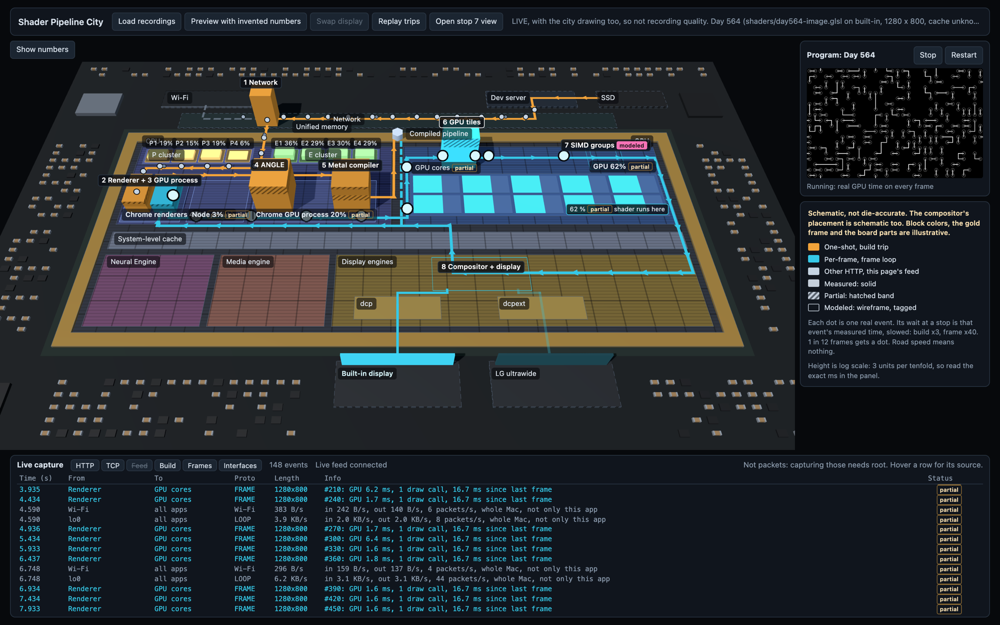

# Shader Pipeline City

Shows the path of one GLSL fragment shader on this Mac as a 3D city. The ground is a schematic
map of the Apple M2 chip. The 8 pipeline stops sit on the hardware blocks where they run, roads
are handoffs, and building height is measured time.



*Live mode, Day 564 (`shaders/day564-image.glsl`) at 1280 x 800. Captured 2026-11-12 in headless
Chrome 157 on the M2 (`--use-angle=metal`), with the city drawing too, so these are not
recording-quality numbers. The map is schematic, not die-accurate.*

## The machine it was built on

Every number in the city was taken on this one Mac. Source: `system_profiler` and `chrome://gpu`,
also listed in `docs/backlog.md`.

| Part | This Mac |
|---|---|
| Computer | MacBook Pro 13" (Mac14,7) |
| Chip | Apple M2 |
| CPU | 8 cores: 4 performance + 4 efficiency |
| GPU | Apple M2, 10 cores, Metal 4 |
| Unified memory | 8 GB |
| WebGL renderer | `ANGLE (Apple, ANGLE Metal Renderer: Apple M2, Unspecified Version)` |
| Display 1 | Built-in Retina, 2560 x 1600, 60 Hz |
| Display 2 | LG ultrawide, 3440 x 1440, 50 Hz |
| OS | macOS 26.6 |
| Browser | Chrome 156 for the probe runs, Chrome 157 now |

The chip map's own numbers (cores, caches, bandwidth) are in `data/hardware-map.m2.json`, each
with its source.

## What it needs to run

**Required**

- **Node.js 24 or newer.** Built with Node 24.21. Earlier versions are untested.
- **Chrome on a Mac.** The city and the recorder use WebGL2. The recorder needs the
  `EXT_disjoint_timer_query_webgl2` extension for GPU time, which Chrome exposes through ANGLE on
  Metal. Safari and Firefox are untested.
- **The Vite dev server (`npm run dev`).** It serves the shaders with `Cache-Control: no-store`,
  sets the headers that make the page cross-origin isolated (so `performance.now()` resolves to
  5 µs instead of 100 µs), and runs the live hardware feed. A static `npm run build` has none of
  this server, so expect no live readings there (not tested).

**Used by the live feed (macOS only, no root needed)**

The dev server reads whole-Mac numbers with built-in macOS commands: `ioreg` (GPU load), `ps`
(CPU time per process), `netstat` and `nettop` (network bytes). If a command fails, the sampler
returns nothing and the city shows "no reading". That path hasn't been tried on another OS.

**Optional**

- **Xcode's Instruments (`xcrun xctrace`)** only for `scripts/importTrace.ts`, which turns a
  Metal System Trace into `data/imports/instruments.json`. The repo already includes that file.

**Not checked:** any Mac other than this M2, and any GPU that isn't Apple's. The map always draws
the M2, whatever the machine. Numbers from another Mac would be real readings drawn on the wrong map.

## Run it

```sh
npm install
npm run dev
```

Then open the page you want on the address Vite prints:

| Page | What it does |
|---|---|
| `index.html` | The city. Draws only; it never measures. |
| `record.html` | The recorder. Raw WebGL2, no Three.js, nothing animating. Keep the city tab closed while it runs. |
| `program.html` | The live shader on its own. |
| `experiments.html` | Saved experiment results for Day 442 and Day 564. |
| `probe.html` | Checks what this browser exposes (timer query, renderer string). |

```sh
# Tests and type check
npm test
npm run build
```

## How to read it

Every number carries one of three labels:

- **Measured:** a browser API reports it directly. Drawn solid.
- **Partial:** a real measurement, but a proxy or one that includes other work. Drawn solid with a hatched band.
- **Modeled:** calculated or inferred, with no measurement behind it. Drawn as a wireframe with a "modeled" tag.

Heights use a log scale, with the exact ms printed on each building. `docs/reading-the-numbers.md`
explains each number in the panel and what you can do with it.

## Docs

- `docs/backlog.md`: tickets, findings, hardware numbers and sources.
- `docs/focus.md`: where this project fits (Output 0) and what comes next.
- `docs/probe-results.md`: whether GPU time can be trusted on this Mac.
- `docs/reading-the-numbers.md`: how to read the panel and the experiments page.
